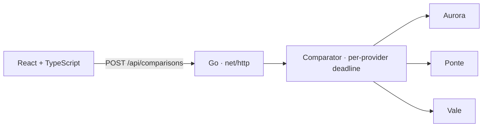

# GEMP

[Português](README.md) · **English**

**A fictional credit comparison tool built with Go and React and TypeScript.** A lower monthly rate can come with a higher upfront fee. GEMP compares total cost and shows what the UI can still deliver when a provider is slow or unavailable.

## Try three scenarios

| Scenario | Result |
| --- | --- |
| **All providers respond** | Three offers sorted by total cost. Compare monthly rates, installments, and upfront fees. |
| **One provider times out** | Two offers remain visible, and the UI identifies the timed-out provider. |
| **All providers are unavailable** | The API returns HTTP 503, and the UI explains that there are no offers in that scenario. |

The providers are simulated in the application process. The form takes an amount, term, and scenario. All rates are fictional. The illustrative total is the sum of rounded installments and the upfront fee.

## Architecture and decisions



- **Go for integration.** The `Provider` interface separates comparison from the source of the offers. Parallel calls use `context.Context` for cancellation and an independent 250 ms deadline per provider.
- **Server-side normalization and ranking.** Each offer ID combines the provider identifier and its local offer ID to prevent collisions. Offers are sorted by total cost in cents, with the ID breaking ties.
- **React and TypeScript for API states.** The UI distinguishes loading, partial results, complete unavailability, and communication failure. Go serves the assets and API from the same origin.

## Run and test

Use Go 1.27.3 and Node.js 22.12 or newer in the 22.x release line.

```bash
npm ci
npm run build
go run ./cmd/gemp
```

Open `http://127.0.0.1:8080`. To exercise the partial result directly:

```bash
curl -sS http://127.0.0.1:8080/api/comparisons \
  -H 'Content-Type: application/json' \
  -d '{"principal_cents":500000,"months":12,"scenario":"one_slow"}'
```

```bash
go test -race ./...
go vet ./...
```

Tests cover parallel calls, cancellation, provider timeouts, invalid offers, duplicate provider-local IDs, total-cost ranking, and HTTP responses. [CI](.github/workflows/ci.yml) also builds the frontend.

## Postman, Insomnia, and verification

Import the [GEMP collection](docs/postman.collection.json) into Postman or Insomnia. With the API running, run the collection to check three sorted offers, partial availability, total failure, and an invalid scenario.
