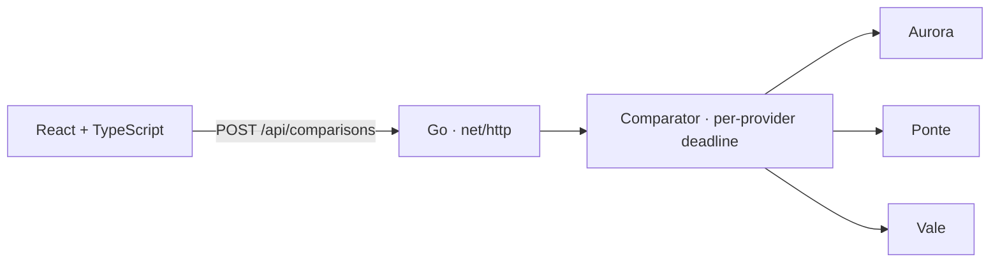

# GEMP

[Português](README.md) · **English** · **[Open the demo](https://acamilateixeira.github.io/GEMP/)**

**A fictional credit comparison tool built with Go and React and TypeScript.** A lower monthly rate can come with a higher upfront fee. GEMP compares total cost and shows what the UI can still deliver when a provider is slow or unavailable.

## Try three scenarios

| Scenario | Result |
| --- | --- |
| **All providers respond** | Three offers sorted by total cost. Compare monthly rates, installments, and upfront fees. |
| **One provider times out** | Two offers remain visible, and the UI identifies the timed-out provider. |
| **All providers are unavailable** | The API returns HTTP 503, and the UI explains that there are no offers in that scenario. |

The list can be re-sorted by total cost, installment, rate, or fee, filtered to offers without an upfront fee, and expanded to show the cost breakdown (interest, fee, and the difference from the cheapest offer). While a comparison runs, **Cancel** stops the provider calls; if the whole comparison takes longer than 5 s, the client cancels it.

The [published demo](https://acamilateixeira.github.io/GEMP/) runs all three scenarios with nothing to install. It has no server: the same Go code as the API is compiled to WebAssembly and runs in the browser, with parallel provider calls and the 250 ms deadline per provider.

The providers are simulated in the application process. The form takes an amount, term, and scenario. All rates are fictional. The illustrative total is the sum of rounded installments and the upfront fee.

## Architecture and decisions



- **Go for integration.** The `Provider` interface separates comparison from the source of the offers. Parallel calls use `context.Context` for cancellation and an independent 250 ms deadline per provider.
- **Server-side normalization and ranking.** Each offer ID combines the provider identifier and its local offer ID to prevent collisions. Offers are sorted by total cost in cents, with the ID breaking ties.
- **One rule, two places.** The `internal/api` package decodes, validates, and compares without `net/http`. The server and the WebAssembly build (`cmd/gemp-wasm`) call the same function, and CI checks that the WebAssembly build answers like the API.
- **React and TypeScript for API states.** The UI distinguishes loading, partial results, complete unavailability, cancellation, client deadline, and communication failure. Go serves the assets and API from the same origin.
- **Real cancellation, not a hidden spinner.** The Cancel button's `AbortSignal` aborts the `fetch` (the server sees the request context canceled) or, in the demo, cancels the `context.Context` the providers receive inside WebAssembly. The promise resolves with 499 so the UI can tell cancellation from failure.
- **Integer cents in the browser too.** The typed amount is parsed into cents as text, never through floating point (`0,29` becomes 29, not 28.999…). Sorting, filtering, and the cost breakdown live in `frontend/src/offers.ts`, free of React, so they can be tested on their own.

## Run and test

Use Go 1.27.3 and Node.js 22.18 or newer in the 22.x release line (frontend tests rely on Node's built-in type stripping).

```bash
npm ci
npm run build
go run ./cmd/gemp
```

Open `http://127.0.0.1:8080`. To exercise the partial result directly:

```bash
curl -sS http://127.0.0.1:8080/api/comparisons \
  -H 'Content-Type: application/json' \
  -d '{"principal_cents":500000,"months":12,"scenario":"one_slow"}'
```

```bash
go test -race ./...
go vet ./...
npm test   # offer list rules (node:test)
```

Tests cover parallel calls, cancellation, provider timeouts, invalid offers, a provider that panics, duplicate provider-local IDs, total-cost ranking, and HTTP responses. Frontend tests cover sorting, tie-breaking, filtering, the cost breakdown, and parsing the typed amount into cents. [CI](.github/workflows/ci.yml) also builds the frontend and runs the WebAssembly build against the same scenarios, including cancellation before and during a comparison (`scripts/wasm-smoke.cjs`). Every change on `main` publishes the page to GitHub Pages through the [demo workflow](.github/workflows/pages.yml).

## Postman, Insomnia, and verification

Import the [Postman collection](docs/postman.collection.json) or the [Insomnia collection](insomnia/gemp.json). With the API running, run the collection to check three sorted offers, partial availability, total failure, and an invalid scenario.
