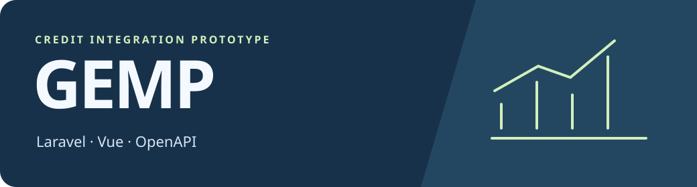
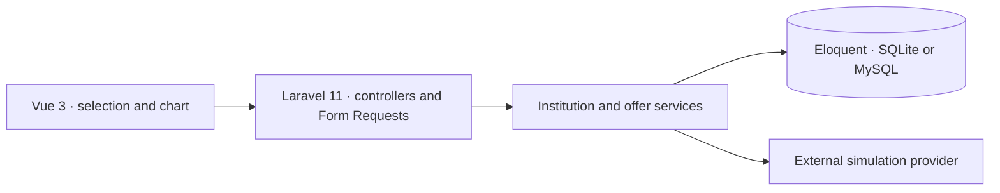

# GEMP

[Português](README.md) · **English**

**A full-stack credit lookup and simulation prototype.** The interface brings together financial institutions and credit types returned by an external API. Users can simulate a credit type and visualize the provider's interest rate, amount limits, and installment ranges.

## From lookup to comparison

1. Enter a test CPF, a Brazilian taxpayer identifier. The Vue interface calls `POST /api/credit-offer` to retrieve institutions and credit types.
2. Laravel validates the input format, queries the provider, and records the lookup, institutions, and credit types in the local database.
3. Selecting a credit type calls `POST /api/credit-simulation`. The application sends the request to the provider and plots the response.

The external provider supplies the simulation results and terms. GEMP organizes the lookup and presentation.

## Architecture and decisions



| Decision | Rationale |
| --- | --- |
| **Vue 3, Axios, and Chart.js** | Keep lookup and comparison in one flow, with a chart for the returned terms. |
| **Laravel 11 with Form Requests and services** | Separate HTTP validation from provider calls and persistence. The default configuration uses SQLite and also supports MySQL. |
| **Swagger / OpenAPI** | Provide an API contract reference. The active routes live in [`routes/api.php`](routes/api.php). |
| **Default HTTP client TLS verification** | The integration sends an identifier to the provider. The client verifies the destination certificate for both operations. |

## Run locally

Use PHP 8.2 or newer with SQLite support, Composer, and Node.js with npm. From the repository root:

```bash
composer install
cp -n .env.example .env
php artisan key:generate
touch database/database.sqlite
php artisan migrate
npm ci
npm run build
php artisan serve --host=127.0.0.1 --port=8000
```

Open `http://127.0.0.1:8000`. Swagger UI is configured at `/api/documentation`. Compare the contract with the [routes](routes/api.php) and [services](app/Services).

## Current limits

Live lookup depends on the external simulation environment. Use provider-approved test data. The [feature tests](tests/Feature) include stub responses for both calls. A standalone public demo needs a simulated provider and a review of how local institution IDs map to provider IDs.
