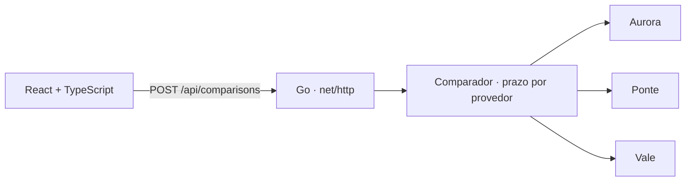

# GEMP

**Português** · [English](README.en.md)

**Comparador de crédito fictício em Go e React e TypeScript.** Uma taxa mensal menor pode vir com uma tarifa inicial maior. O GEMP compara o custo total das ofertas e mostra o que a interface ainda consegue entregar quando um provedor demora ou fica fora do ar.

## Explore três cenários

| Cenário | Resultado |
| --- | --- |
| **Todos respondem** | Três ofertas ordenadas pelo custo total. Compare a taxa mensal, o valor de cada parcela e a tarifa inicial. |
| **Um provedor excede o prazo** | Duas ofertas são exibidas, com indicação do provedor que excedeu o prazo. |
| **Todos indisponíveis** | A API devolve HTTP 503 e a interface explica que não há oferta disponível naquele cenário. |

Os provedores são simulados no próprio processo. O formulário recebe valor, prazo e cenário. As taxas são fictícias. O custo ilustrativo soma as parcelas arredondadas e a tarifa inicial.

## Arquitetura e decisões



- **Go para a integração.** A interface `Provider` separa a comparação da origem das ofertas. Chamadas paralelas usam `context.Context` para cancelar a busca e impor um prazo independente de 250 ms por provedor.
- **Normalização e ordenação no servidor.** O ID da oferta combina o identificador do provedor com o ID devolvido por ele. Isso evita colisões entre catálogos. A ordenação usa o total em centavos e desempata por ID.
- **React e TypeScript para apresentar os estados da API.** O front-end distingue espera, resposta parcial, indisponibilidade total e falha de comunicação. A aplicação Go serve os assets e a API na mesma origem.

## Rodar e testar

Use Go 1.27.3 e Node.js 22.12 ou superior na série 22.

```bash
npm ci
npm run build
go run ./cmd/gemp
```

Abra `http://127.0.0.1:8080`. Para testar a resposta parcial diretamente:

```bash
curl -sS http://127.0.0.1:8080/api/comparisons \
  -H 'Content-Type: application/json' \
  -d '{"principal_cents":500000,"months":12,"scenario":"one_slow"}'
```

```bash
go test -race ./...
go vet ./...
```

Os testes cobrem chamadas simultâneas, cancelamento, prazo excedido, ofertas inválidas, IDs iguais entre provedores, custo total e respostas HTTP. O [CI](.github/workflows/ci.yml) também compila a interface.
