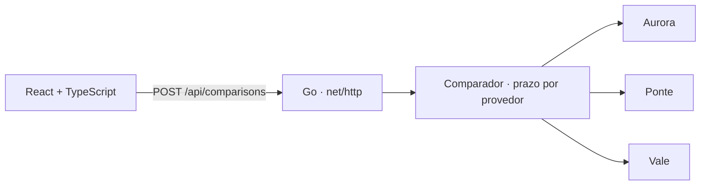

# GEMP

**Português** · [English](README.en.md) · **[Abrir a demo](https://acamilateixeira.github.io/GEMP/)**

**Comparador de crédito fictício em Go e React e TypeScript.** Uma taxa mensal menor pode vir com uma tarifa inicial maior. O GEMP compara o custo total das ofertas e mostra o que a interface ainda consegue entregar quando um provedor demora ou fica fora do ar.

## Explore três cenários

| Cenário | Resultado |
| --- | --- |
| **Todos respondem** | Três ofertas ordenadas pelo custo total. Compare a taxa mensal, o valor de cada parcela e a tarifa inicial. |
| **Um provedor excede o prazo** | Duas ofertas são exibidas, com indicação do provedor que excedeu o prazo. |
| **Todos indisponíveis** | A API devolve HTTP 503 e a interface explica que não há oferta disponível naquele cenário. |

Na lista, dá para reordenar por custo total, parcela, taxa ou tarifa, filtrar ofertas sem tarifa inicial e abrir a composição do custo (juros, tarifa e diferença para a mais barata). Durante a consulta, **Cancelar** interrompe as chamadas aos provedores; se a comparação inteira passar de 5 s, o cliente cancela sozinho.

A [demo publicada](https://acamilateixeira.github.io/GEMP/) roda os três cenários sem instalar nada. Ela não tem servidor: o mesmo código Go da API é compilado para WebAssembly e roda no navegador, com as consultas em paralelo e o prazo de 250 ms por provedor.

Os provedores são simulados no próprio processo. O formulário recebe valor, prazo e cenário. As taxas são fictícias. O custo ilustrativo soma as parcelas arredondadas e a tarifa inicial.

## Arquitetura e decisões



- **Go para a integração.** A interface `Provider` separa a comparação da origem das ofertas. Chamadas paralelas usam `context.Context` para cancelar a busca e impor um prazo independente de 250 ms por provedor.
- **Normalização e ordenação no servidor.** O ID da oferta combina o identificador do provedor com o ID devolvido por ele. Isso evita colisões entre catálogos. A ordenação usa o total em centavos e desempata por ID.
- **Uma regra, dois lugares.** O pacote `internal/api` decodifica, valida e compara sem depender de `net/http`. O servidor e o build WebAssembly (`cmd/gemp-wasm`) chamam a mesma função, e o CI confere que o WebAssembly responde como a API.
- **React e TypeScript para apresentar os estados da API.** O front-end distingue espera, resposta parcial, indisponibilidade total, cancelamento, prazo excedido e falha de comunicação. A aplicação Go serve os assets e a API na mesma origem.
- **Cancelamento real, não visual.** O `AbortSignal` do botão Cancelar aborta o `fetch` (o servidor vê o contexto da requisição cancelado) ou, na demo, cancela o `context.Context` que os provedores recebem dentro do WebAssembly. A promessa devolve 499 para a interface distinguir cancelamento de falha.
- **Valores em centavos inteiros também no navegador.** O valor digitado é convertido em centavos por texto, sem ponto flutuante (`0,29` vira 29, não 28,999…). Ordenação, filtro e composição do custo ficam em `frontend/src/offers.ts`, sem React, para serem testados isoladamente.

## Rodar e testar

Use Go 1.27.3 e Node.js 22.18 ou superior na série 22 (os testes do front-end usam a remoção de tipos nativa do Node).

```bash
npm ci
npm run build
go run ./cmd/gemp
```

Abra `http://127.0.0.1:8080`. Para testar a resposta parcial diretamente:

```bash
curl -sS http://127.0.0.1:8080/api/comparisons \
  -H 'Content-Type: application/json' \
  -d '{"principal_cents":500000,"months":12,"scenario":"one_slow"}'
```

```bash
go test -race ./...
go vet ./...
npm test   # regras da lista de ofertas (node:test)
```

Os testes cobrem chamadas simultâneas, cancelamento, prazo excedido, ofertas inválidas, provedor que entra em panic, IDs iguais entre provedores, custo total e respostas HTTP. Os testes do front-end cobrem ordenação, desempate, filtro, composição do custo e a conversão do valor digitado em centavos. O [CI](.github/workflows/ci.yml) também compila a interface e roda o build WebAssembly contra os mesmos cenários, incluindo o cancelamento antes e durante a consulta (`scripts/wasm-smoke.cjs`). A cada mudança na `main`, o [workflow da demo](.github/workflows/pages.yml) publica a página no GitHub Pages.

## Postman, Insomnia e verificação

Importe a [coleção do Postman](docs/postman.collection.json) ou a [coleção do Insomnia](insomnia/gemp.json). Com a API aberta, rode a coleção para conferir três ofertas ordenadas, resposta parcial, indisponibilidade total e cenário inválido.
