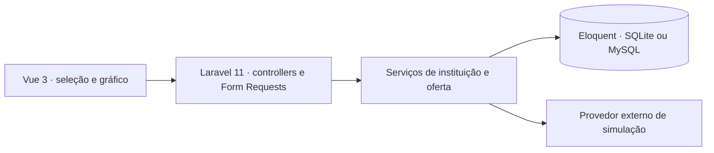

# GEMP

**Português** · [English](README.en.md)

**Protótipo full stack de consulta e simulação de crédito.** A interface reúne instituições e modalidades devolvidas por uma API externa. A pessoa pode simular uma modalidade e visualizar os juros e os limites de valor e de parcelas recebidos do provedor.

## Da consulta à comparação

1. A pessoa informa um CPF de teste. A tela Vue chama `POST /api/credit-offer` para consultar as instituições e modalidades.
2. O Laravel valida o formato da entrada, consulta o provedor e registra a consulta, as instituições e as modalidades no banco local.
3. Ao selecionar uma modalidade, a tela chama `POST /api/credit-simulation`. A aplicação repassa a solicitação ao provedor e a interface apresenta a resposta em um gráfico.

O cálculo e as condições são fornecidos pelo serviço externo. O GEMP organiza a consulta e a visualização.

## Arquitetura e escolhas



| Decisão | Motivo |
| --- | --- |
| **Vue 3, Axios e Chart.js** | Manter a consulta e a comparação no mesmo fluxo, com um gráfico para as condições retornadas. |
| **Laravel 11 com Form Requests e serviços** | Separar a validação HTTP das chamadas ao provedor e da persistência. A configuração padrão usa SQLite e também contempla MySQL. |
| **Swagger / OpenAPI** | Dar uma referência do contrato da API. As rotas efetivas ficam em [`routes/api.php`](routes/api.php). |
| **Validação TLS padrão do cliente HTTP** | A integração envia um identificador ao provedor. O cliente verifica o certificado do destino nas duas operações. |

## Rodar localmente

Use PHP 8.2 ou superior com a extensão SQLite, Composer e Node.js com npm. No diretório do repositório:

```bash
composer install
cp -n .env.example .env
php artisan key:generate
touch database/database.sqlite
php artisan migrate
npm ci
npm run build
php artisan serve --host=127.0.0.1 --port=8000
```

Abra `http://127.0.0.1:8000`. A interface do Swagger é configurada em `/api/documentation`. Para comparar o contrato com o código, consulte [as rotas](routes/api.php) e [os serviços](app/Services).

## Limites atuais

A consulta ao vivo depende do ambiente externo de simulação. Use dados de teste autorizados pelo provedor. Os [testes de feature](tests/Feature) incluem respostas simuladas para as duas chamadas. A publicação de uma demo independente exige um provedor simulado e revisão do mapeamento entre IDs locais e IDs devolvidos pelo provedor.
